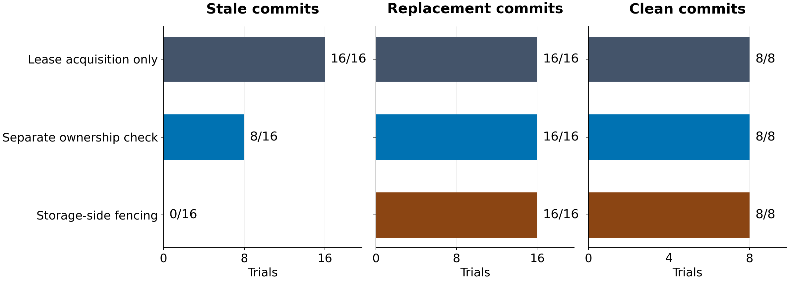

# Stale worker fencing lab

A reproducible local fault matrix for background-agent infrastructure. Two owned Python worker processes operate on a synthetic SQLite resource; an old worker is held at an IPC barrier while its replacement commits a newer result.

This is a deterministic engineering counterexample, not an LLM benchmark or a reproduction of any vendor incident. The question differs from retry deduplication: different worker generations may overwrite each other even when no request is retried.

## Conditions

- **Lease acquisition only:** obtain ownership when starting work; accept the eventual write.
- **Separate ownership check:** verify the owner/generation/expiry, return from that check, then write. A handoff may occur between these operations.
- **Storage-side fencing:** send a monotonically increasing token with the write; compare it with the last accepted token and update the resource and write history in one SQLite transaction. Older tokens are rejected after a higher-token write.

Fencing here is neither lease-expiry revocation nor authentication, deduplication or an external-effect guarantee. A token can still write after expiry if no higher token has been committed, and same-token writes remain allowed. Acceptance tests explicitly check these boundaries.

## Design and data

Read [PROTOCOL.md](PROTOCOL.md), frozen before primary measurement, and [SOURCES.json](SOURCES.json). Eight authored payload pairs cross three conditions and three schedules: clean execution, handoff before the ownership check, and handoff between check and write. Total: 72 trials, including 24 clean negative-control trials. The eight payload variants are coverage fixtures, not independent samples of production reliability.

The two workers have different process IDs and separate connections. A driver controls logical time and command order. Waiting at the command boundary does not simulate arbitrary OS scheduling, network faults or a real clock. No transaction spans a barrier. Both the lease allocator and resource are in one local SQLite database; no distributed token allocator, Redis cluster or remote API was tested.

## Reproduce

Python 3.11+ and SQLite are sufficient for all checks, orchestration and independent auditing. No packages or model services are needed to reproduce the measured matrix. Exact recorded versions are in `evidence/environment.json`. Chart rendering additionally uses the already installed Matplotlib recorded there.

```sh
python3 -B tests/run_checks.py
python3 -B audit.py
python3 -B harness.py --output results/replay
python3 -B audit.py --run results/replay --output results/replay-audit.json
python3 plot.py
```

The runner refuses an existing output directory. Choose a fresh directory for another explicitly requested replay; preserve old runs. The checked-in primary run is never overwritten. `make_fixtures.py` regenerates the fixed fixtures and deterministic order with seed 20261116. `frozen.json` records hashes for scientific files before measurement. `evidence/release.json` records the measured implementation commit. Data and source code are authored synthetic material under the included MIT license; source pages are referenced, not redistributed.

## Measured results

| Policy | Stale commits after replacement | Replacement commits | Clean commits |
|---|---:|---:|---:|
| Lease acquisition only | 16/16 | 16/16 | 8/8 |
| Separate ownership check | 8/16 | 16/16 | 8/8 |
| Storage-side fencing | 0/16 | 16/16 | 8/8 |

Every accepted stale commit also left the stale payload as the final resource value. The separate precheck rejected the old worker in all 8 handoff-before-check cases, but accepted its old prepared write in all 8 handoff-after-check cases. The fenced condition rejected both handoff schedules. There were no missing cells, unexpected worker exits, nonempty worker stderr or database integrity errors. All 72 trials and 13 frozen file hashes passed the separate audit; the fixed acceptance suite passed 8/8.



Chart alt text: For lease-only, separate precheck and storage-side fencing respectively, stale commits were 16/16, 8/16 and 0/16. Replacement writes were 16/16 for every policy, and clean writes were 8/8 for every policy. Exact per-case rows are in results/primary/.

The checked-in PNG/SVG were rendered from `results/audit.json` by `plot.py`, with no statistical intervals, smoothing or data-dependent case selection. Equal payload variants cover serialization formats; they do not increase the number of distinct fault schedules.

## Evidence and tooling

`results/primary/` contains every command/request, raw response, PID, child exit code/stderr, database snapshot and final SQLite database. `results/primary/summary.json` is the primary scorer output. `audit.py` imports neither `store.py` nor `harness.py`; it reconstructs the schedule and event chronology, validates every persisted transition and final database, checks all frozen hashes, and independently counts outcomes. Positive, negative, missing-event and malformed-response scorer controls ran before the matrix.

[INVARIANT](https://github.com/Xenox-developer/invariant) 0.3.1 coordinated the Codex implementation of `store.py`, the protected eight-test acceptance suite, semantic review and guarded application. The host harness then executed the measured processes. No LLM responses were measured. `evidence/invariant.json` preserves actual IDs, execution/validation receipts, application verification and complete available usage; `evidence/usage.json` summarizes that accounting without interpreting subscription tokens as dollars. An initial host-delivery conflict correctly preserved a concurrently edited auditor; its original hash was restored and a fresh guarded plan applied the identical reviewed store. This recovery used the original task/attempt and did not dispatch another implementation worker. Replay-directory CLI arguments were added to the separate auditor only after delivery and before the measurement freeze. The public evidence records this history. Raw private tool output remains outside the public repository. The public receipt retains relevant execution witnesses; private machine/account state is not part of this repository.

## Limitations

All schedules are chosen counterexamples with deterministic logical time, not randomly sampled incidents. Counts describe only these cases. There are no confidence intervals, timing comparisons, real agents, model-quality conclusions, distributed consensus/failover, power-loss tests or third-party systems. Storage-side fencing requires enforcement by the resource being protected; this local result does not protect external services that ignore the token. This project does not modify the actual LinkedIn publishing automation.

## Sources and software

- William Hu / Anthropic, *Building always-on agents*, November 13, 2026: https://claude.com/resources/articles/building-always-on-agents . The discussion of competing runs motivates the local question; no defect is attributed to Claude.
- Redis documentation, *Distributed Locks*, consistency section (checked November 16, 2026): https://redis.io/docs/latest/develop/clients/patterns/distributed-locks/ . It calls for fencing tokens for long-running processes. This study is not a Redis benchmark.
- Martin Kleppmann, *How to do distributed locking*, February 8, 2016: https://martin.kleppmann.com/2016/02/08/how-to-do-distributed-locking.html . Primary explanation of storage rejecting smaller fencing tokens after a larger one.
- Figure preparation used the installed Scientific Visualization procedural skill. Reference verified November 16, 2026: Timothy Kassis, Vinayak Agarwal, Yuhuan He, Darshil Patel, Aubrey M. Brueckner (2026), *Scientific Agent Skills: A Library of Procedural Knowledge for Research Agents*, arXiv:2609.00065, current record v2: https://doi.org/10.48550/arXiv.2609.00065 . This is a tooling reference, not evidence for the measured results.
